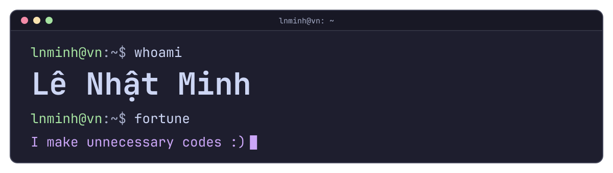

<p align="center">
  <a href="https://lnminh1411.is-a.dev">
    <picture>
      <source media="(prefers-color-scheme: dark)" srcset="./assets/banner-dark.svg">
      <source media="(prefers-color-scheme: light)" srcset="./assets/banner-light.svg">
      
    </picture>
  </a>
</p>

<p align="center">
  Student and Self-taught, AI Assisted Developer from Vietnam 🇻🇳<br>
  Website: <a href="https://lnminh1411.is-a.dev">lnminh1411.is-a.dev</a>
</p>

<h2 align="center">Skills, without AI assistance</h2>

<p align="center">
<a href="https://www.python.org/"></a>
<a href="https://developer.mozilla.org/docs/Web/JavaScript"></a>
<a href="https://www.typescriptlang.org/"></a>
<a href="https://nodejs.org/"></a>
<a href="https://developer.mozilla.org/docs/Web/HTML"></a>
<a href="https://developer.mozilla.org/docs/Web/CSS"></a>
</p>

<h2 align="center">Tools I use</h2>

<p align="center">
<a href="https://git-scm.com/"></a>
<a href="https://learn.microsoft.com/windows/wsl/"></a>
<a href="https://ubuntu.com/"></a>
<a href="https://brave.com/download-nightly/"></a>
<a href="https://code.visualstudio.com/insiders/"></a>
<a href="https://visualstudio.microsoft.com/"></a>
</p>

<h2 align="center">AI agents</h2>

<p align="center">
<a href="https://claude.com/claude-code"></a>
<a href="https://antigravity.google"></a>

</p>

<h2 align="center">Featured projects</h2>

<p align="center">
<a href="https://github.com/lnminh1411/ESP32-PC-Control-System"><picture><source media="(prefers-color-scheme: dark)" srcset="https://lnminh-stats.vercel.app/api/pin?username=lnminh1411&border_radius=12&repo=ESP32-PC-Control-System&description_lines_count=2&hide_border=true&bg_color=1e1e2e&title_color=cba6f7&text_color=cdd6f4&icon_color=cba6f7"><source media="(prefers-color-scheme: light)" srcset="https://lnminh-stats.vercel.app/api/pin?username=lnminh1411&border_radius=12&repo=ESP32-PC-Control-System&description_lines_count=2&hide_border=true&bg_color=eff1f5&title_color=8839ef&text_color=4c4f69&icon_color=8839ef"></picture></a>
<a href="https://github.com/lnminh1411/P2B-VAIC-Hackathon"><picture><source media="(prefers-color-scheme: dark)" srcset="https://lnminh-stats.vercel.app/api/pin?username=lnminh1411&border_radius=12&repo=P2B-VAIC-Hackathon&description_lines_count=2&hide_border=true&bg_color=1e1e2e&title_color=cba6f7&text_color=cdd6f4&icon_color=cba6f7"><source media="(prefers-color-scheme: light)" srcset="https://lnminh-stats.vercel.app/api/pin?username=lnminh1411&border_radius=12&repo=P2B-VAIC-Hackathon&description_lines_count=2&hide_border=true&bg_color=eff1f5&title_color=8839ef&text_color=4c4f69&icon_color=8839ef"></picture></a>
</p>

<details>
<summary><b>My PC</b> (<code>neofetch</code>)</summary>

```text
OS        Windows Insider Experimental (Future Platforms)
CPU       Intel Core Ultra 7 265K
Board     Gigabyte B860M GAMING X WIFI 6E (rev 1.0)
RAM       64 GB DDR5-6000 CL36 (G.Skill Trident Z5 Neo 2x32)
GPU       Asus Dual RX 6600 + Gigabyte RTX 3050 6GB
Storage   Kioxia Exceria Plus G3 1TB, WD Blue SN550 500GB,
          Colorful SL500 256GB, Kingston A400 120GB, WD Blue 1TB HDD
PSU       Darkflash PMT750 Gold
Cooling   ID-Cooling FX240 INF ARGB
Case      Kenoo Esport EM700-3F
Displays  MSI Pro MP275 + 2x Dell E1715S
Extra     ESP32-S3 N16R8 control board
```

</details>

<h2 align="center">Stats</h2>

<p align="center">
<picture><source media="(prefers-color-scheme: dark)" srcset="https://lnminh-trophy.vercel.app/?username=lnminh1411&theme=catppuccin_mocha&column=4&no-frame=true&no-bg=true&title=Joined2020%2CExperience%2CCommits%2CIssues%2CPullRequest%2CRepositories%2CFollowers%2CStars"><source media="(prefers-color-scheme: light)" srcset="https://lnminh-trophy.vercel.app/?username=lnminh1411&theme=catppuccin_latte&column=4&no-frame=true&no-bg=true&title=Joined2020%2CExperience%2CCommits%2CIssues%2CPullRequest%2CRepositories%2CFollowers%2CStars"></picture>
</p>

<p align="center">
<picture><source media="(prefers-color-scheme: dark)" srcset="https://lnminh-stats.vercel.app/api?username=lnminh1411&border_radius=12&show_icons=true&hide_border=true&bg_color=1e1e2e&title_color=cba6f7&text_color=cdd6f4&icon_color=cba6f7"><source media="(prefers-color-scheme: light)" srcset="https://lnminh-stats.vercel.app/api?username=lnminh1411&border_radius=12&show_icons=true&hide_border=true&bg_color=eff1f5&title_color=8839ef&text_color=4c4f69&icon_color=8839ef"></picture>
<picture><source media="(prefers-color-scheme: dark)" srcset="https://lnminh-stats.vercel.app/api/top-langs?username=lnminh1411&border_radius=12&layout=compact&langs_count=8&hide_border=true&size_weight=0.5&count_weight=0.5&bg_color=1e1e2e&title_color=cba6f7&text_color=cdd6f4"><source media="(prefers-color-scheme: light)" srcset="https://lnminh-stats.vercel.app/api/top-langs?username=lnminh1411&border_radius=12&layout=compact&langs_count=8&hide_border=true&size_weight=0.5&count_weight=0.5&bg_color=eff1f5&title_color=8839ef&text_color=4c4f69"></picture>
</p>

<p align="center">
<picture><source media="(prefers-color-scheme: dark)" srcset="https://lnminh-streak.vercel.app/?user=lnminh1411&border_radius=12&hide_border=true&background=1E1E2E&ring=CBA6F7&fire=FAB387&currStreakNum=CDD6F4&sideNums=CDD6F4&currStreakLabel=CBA6F7&sideLabels=BAC2DE&dates=A6ADC8&stroke=45475A"><source media="(prefers-color-scheme: light)" srcset="https://lnminh-streak.vercel.app/?user=lnminh1411&border_radius=12&hide_border=true&theme=catppuccin-latte"></picture>
</p>

<h2 align="center">Contact</h2>

<p align="center">
<a href="https://discord.com/users/1243939761614356544"></a>
<a href="https://www.instagram.com/im.lnminh1411"></a>
<a href="https://www.facebook.com/im.lnminh1411"></a>
<a href="https://www.linkedin.com/in/nh%E1%BA%ADt-minh-l%C3%AA-a087a5425/"></a>
</p>

<p align="center">
<b>Email</b><br>
<a href="mailto:contact@lnminh1411.is-a.dev">contact@lnminh1411.is-a.dev</a><br>
<a href="mailto:it@bsb-travel.com">it@bsb-travel.com</a>
</p>
